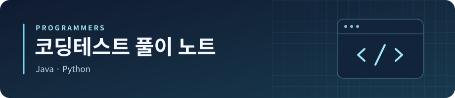

<div align="center">



프로그래머스 문제를 Java와 Python으로 풀며, 어떻게 접근했고 어디서 막혔는지 기록합니다.

**61개 풀이 노트**

<a href="#lv0"></a>
<a href="#lv1"></a>
<a href="#lv2"></a>
<a href="#etc"></a>

<a href="https://programmers.co.kr/"></a>
<a href="https://velog.io/@choihwanwoo"></a>
<a href="https://github.com/choihwanwoo"></a>

</div>

---

## 전체 풀이 목록

레벨을 펼친 뒤 문제 제목을 누르면 풀이 노트가 열립니다. 노트에는 접근 과정, 오답노트, 정답 코드를 정리했습니다.

<a id="lv0"></a>

<details>
<summary><b>Lv.0 · 코딩테스트 입문 · 49문제</b></summary>

| # | 문제 | 언어 |
| :-: | --- | :---: |
| 01 | [두 수의 나눗셈](./lv0/두-수의-나눗셈.md) | `Java` |
| 02 | [두 수의 차](./lv0/두-수의-차.md) | `Java` |
| 03 | [문자 출력](./lv0/문자-출력.md) | `Java` |
| 04 | [각도 합치기](./lv0/각도-합치기.md) | `Java` |
| 05 | [분수의 덧셈](./lv0/분수의-덧셈.md) | `Java` |
| 06 | [배열 두배 만들기](./lv0/배열-두배-만들기.md) | `Java` |
| 07 | [중앙값 구하기](./lv0/중앙값-구하기.md) | `Java` |
| 08 | [최빈값 구하기](./lv0/최빈값-구하기.md) | `Java` |
| 09 | [짝수는 싫어요](./lv0/짝수는-싫어요.md) | `Java` |
| 10 | [피자 나눠 먹기 (1)](./lv0/피자-나눠-먹기-1.md) | `Java` |
| 11 | [피자 나눠 먹기 (2)](./lv0/피자-나눠-먹기-2.md) | `Java` |
| 12 | [배열의 평균값](./lv0/배열의-평균값.md) | `Java` |
| 13 | [옷가게 할인 받기](./lv0/옷가게-할인-받기.md) | `Java` |
| 14 | [문자 리스트를 문자열로 변환하기](./lv0/문자-리스트를-문자열로-변환하기.md) | `Python` |
| 15 | [대소문자 바꿔서 출력하기](./lv0/대소문자-바꿔서-출력하기.md) | `Python` |
| 16 | [홀짝 구분하기](./lv0/홀짝-구분하기.md) | `Python` |
| 17 | [연속된 수의 합](./lv0/연속된-수의-합.md) | `Python` |
| 18 | [OX퀴즈](./lv0/OX퀴즈.md) | `Python` |
| 19 | [다음에 올 숫자](./lv0/다음에-올-숫자.md) | `Python` |
| 20 | [옹알이 (1)](./lv0/옹알이-1.md) | `Java` |
| 21 | [정수를 나선형으로 배치하기](./lv0/정수를-나선형으로-배치하기.md) | `Python` |
| 22 | [겹치는 선분의 길이](./lv0/겹치는-선분의-길이.md) | `Python` |
| 23 | [평행](./lv0/평행.md) | `Python` |
| 24 | [안전지대](./lv0/안전지대.md) | `Python` |
| 25 | [다항식 더하기](./lv0/다항식-더하기.md) | `Python` |
| 26 | [코드 처리하기](./lv0/코드-처리하기.md) | `Python` |
| 27 | [배열 조각하기](./lv0/배열-조각하기.md) | `Python` |
| 28 | [특이한 정렬](./lv0/특이한-정렬.md) | `Python` |
| 29 | [문자열 밀기](./lv0/문자열-밀기.md) | `Python` |
| 30 | [유한소수 판별하기](./lv0/유한소수-판별하기.md) | `Python` |
| 31 | [직사각형 넓이 구하기](./lv0/직사각형-넓이-구하기.md) | `Python` |
| 32 | [치킨 쿠폰](./lv0/치킨-쿠폰.md) | `Python` |
| 33 | [등수 매기기](./lv0/등수-매기기.md) | `Python` |
| 34 | [종이 자르기](./lv0/종이-자르기.md) | `Python` |
| 35 | [전국 대회 선발 고사](./lv0/전국-대회-선발-고사.md) | `Python` |
| 36 | [외계어 사전](./lv0/외계어-사전.md) | `Python` |
| 37 | [정사각형으로 만들기](./lv0/정사각형으로-만들기.md) | `Python` |
| 38 | [구슬을 나누는 경우의 수](./lv0/구슬을-나누는-경우의-수.md) | `Python` |
| 39 | [뒤집힌 문자열](./lv0/뒤집힌-문자열.md) | `Python` |
| 40 | [그림 확대](./lv0/그림-확대.md) | `Python` |
| 41 | [로그인 성공?](./lv0/로그인-성공.md) | `Python` |
| 42 | [마지막 두 원소](./lv0/마지막-두-원소.md) | `Python` |
| 43 | [아이스 아메리카노](./lv0/아이스-아메리카노.md) | `Python` |
| 44 | [카운트 업](./lv0/카운트-업.md) | `Python` |
| 45 | [캐릭터의 좌표](./lv0/캐릭터의-좌표.md) | `Python` |
| 46 | [공 던지기](./lv0/공-던지기.md) | `Python` |
| 47 | [삼각형의 완성조건 (2)](./lv0/삼각형의-완성조건-2.md) | `Python` |
| 48 | [영어가 싫어요](./lv0/영어가-싫어요.md) | `Python` |
| 49 | [주사위 게임 3](./lv0/주사위-게임-3.md) | `Python` |

</details>

<a id="lv1"></a>

<details>
<summary><b>Lv.1 · 7문제</b></summary>

| # | 문제 | 언어 |
| :-: | --- | :---: |
| 01 | [중요한 단어를 스포 방지](./lv1/중요한-단어를-스포-방지.md) | `Python` |
| 02 | [가장 많이 받은 선물](./lv1/가장-많이-받은-선물.md) | `Python` |
| 03 | [노란불 신호등](./lv1/노란불-신호등.md) | `Python` |
| 04 | [달리기 경주](./lv1/달리기-경주.md) | `Python` |
| 05 | [유연근무제](./lv1/유연근무제.md) | `Python` |
| 06 | [추억 점수](./lv1/추억-점수.md) | `Python` |
| 07 | [택배 상자 꺼내기](./lv1/택배-상자-꺼내기.md) | `Python` |

</details>

<a id="lv2"></a>

<details>
<summary><b>Lv.2 · 2문제</b></summary>

| # | 문제 | 언어 |
| :-: | --- | :---: |
| 01 | [최고의 집합](./lv2/최고의-집합.md) | `Java` |
| 02 | [점 찍기](./lv2/점-찍기.md) | `Java` |

</details>

<a id="etc"></a>

<details>
<summary><b>기타 · PCCE 및 연습 · 3문제</b></summary>

| # | 문제 |
| :-: | --- |
| 01 | [수 나누기 (PCCE)](./etc/수-나누기.md) |
| 02 | [병과 분류](./etc/병과분류.md) |
| 03 | [심폐소생술](./etc/심폐소생술.md) |

</details>

---

## 폴더 안내

```text
coding-test/
├── lv0/      ·  입문 문제
├── lv1/      ·  Lv.1 풀이
├── lv2/      ·  Lv.2 풀이
├── etc/      ·  PCCE와 기타 연습
├── assets/   ·  README 이미지
└── README.md
```
